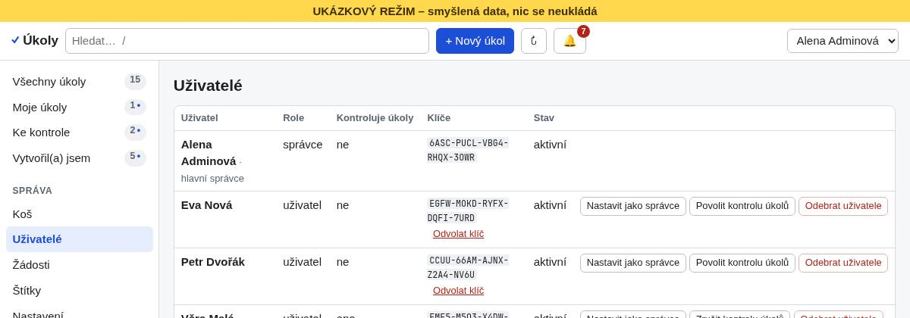
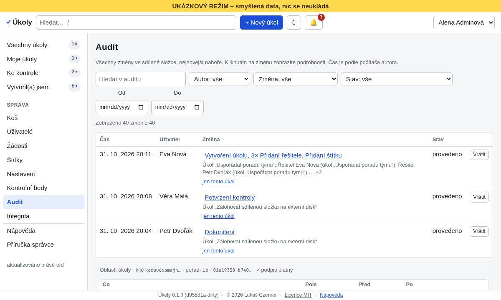

# Příručka správce

Tato příručka je pro správce aplikace Úkoly. Popisuje instalaci, správu uživatelů a klíčů, nastavení, audit, řešení problémů s integritou, aktualizace a zálohy. Běžnou práci s úkoly popisuje [Nápověda](#/help).

Obrazovky pro správu najdete v levém panelu pod nadpisem **Správa**. Ostatní uživatelé je nevidí. Každou změnu, kterou správce udělá, podepisuje jeho klíč a ostatní počítače ji samy kontrolují. Skutečná ochrana tedy není skrytí obrazovky, ale tato kontrola.

## 1. Jak aplikace funguje

- Aplikace je 1 soubor `app/index.html` ve sdílené složce na OneDrive. Nemá server a neposílá nic do sítě.
- Každá změna je 1 nový soubor ve složce `roles` nebo `data`. Soubor podepisuje klíč autora. Soubory změn se nikdy nemění ani nemažou.
- Každý počítač načte všechny soubory změn, zkontroluje podpisy a oprávnění a sestaví z nich stejný stav.
- Oprávnění kontroluje každý počítač při každém načtení. Uživatel, který omylem smí zapisovat do složky `roles`, přesto nemůže změnit role.

> **Nikdy nemažte ani neupravujte soubory ve složkách `roles` a `data`.** Smazaný nebo změněný soubor zastaví všechny pozdější změny daného autora (kapitola 8).

## 2. Instalace (jednou)

### Složka a oprávnění na OneDrive

1. Rozbalte archiv vydání `mytasker-<verze>.zip`. Jako cíl zvolte svou složku OneDrive (nebo synchronizovanou složku SharePointu), ne novou složku podle názvu archivu. Vznikne složka `Ukoly`. Můžete ji přejmenovat, například na `Úkoly`.
2. Zkontrolujte, že složka obsahuje podsložky `app`, `roles/ops`, `roles/checkpoints`, `data/ops`, `data/checkpoints`, `data/files` a `enroll`. Bez archivu je vytvořte ručně.
3. Ve složce `app` musí být soubory vydání: `index.html`, `LICENSE`, `THIRD-PARTY-NOTICES.md`, `VERSION` a `SHA256SUMS`. Archiv je obsahuje. Bez archivu je tam zkopírujte.
4. Nastavte oprávnění podle seznamu pod tímto postupem.
5. Sdílejte složku s týmem. Každý si ji musí synchronizovat na svůj počítač.

Oprávnění ke složkám:

- `app` a `roles`: zápis jen správci, čtení všichni.
- `data`: zápis i čtení všichni.
- `enroll`: zápis všichni. Čtení stačí správcům, ale OneDrive to ne vždy umí oddělit.

### První správce

1. Otevřete `app/index.html` v Edge nebo Chrome (verze 137 nebo novější) a vyberte hlavní složku.
2. Aplikace nenajde kořen důvěry a nabídne **Vytvořit novou instalaci**.
3. Zadejte jméno a heslo, uložte soubor s klíčem do své osobní složky a potvrďte. Aplikace zapíše `app/trust-root.json`.
4. Zapište si **otisk kořene důvěry**, který aplikace ukazuje na úvodní obrazovce. Uživatelé si ho mohou ověřit u vás.
5. Co nejdříve přidejte **druhého správce** (kapitoly 3 a 4) a nechte ho zapsat do kořene důvěry jako druhého hlavního správce (`docs/operations.md`). Když přijdete o klíč a nebude jiný správce, správa se zastaví, dokud někdo ručně neupraví soubor `app/trust-root.json`.

## 3. Schválení nového uživatele

1. Uživatel odešle žádost podle kapitoly 2 nápovědy a sdělí vám otisk.
2. Otevřete **Správa → Žádosti**.
3. Porovnejte otisk v žádosti s otiskem od uživatele, znak po znaku. Otisk si nechte sdělit telefonem nebo osobně, ne e-mailem ani chatem.
4. V poli **Schválit jako** zvolte pro nového člověka **Nový uživatel**. Když stávající uživatel ztratil klíč nebo má nový počítač, zvolte **Nový klíč pro uživatele …**.
5. Klikněte na **Schválit**.

> **Když otisk nesouhlasí, žádost neschvalujte.** Žádost mohl vytvořit někdo jiný. Požádejte uživatele o novou žádost.

Schválení se k uživateli dostane synchronizací OneDrive. Jeho aplikace se pak otevře sama.

## 4. Uživatelé, role a klíče

Obrazovka **Správa → Uživatelé** ukazuje všechny uživatele, jejich role, právo kontrolovat úkoly, klíče a stav.

- **Nastavit jako správce** a **Odebrat práva správce**: správce může vše, co popisuje tato příručka.
- **Povolit kontrolu úkolů** a **Zrušit kontrolu úkolů**: kdo kontroluje úkoly, smí hotový úkol potvrdit jako zkontrolovaný nebo vrátit k přepracování. Správce to smí vždy.
- **Odebrat uživatele**: uživatel ztratí přístup. Jeho dosavadní změny zůstanou platné. Aplikace nabídne, že ho odebere i z řešitelů otevřených úkolů. Odebrání nejde vrátit. Když se člověk vrátí, pošle novou žádost a schválíte ho jako nového uživatele.
- **Odvolat klíč**: použijte při ztrátě nebo krádeži klíče. Změny, které klíč zapsal dosud, zůstanou platné. Každá další změna s tímto klíčem bude odmítnuta. Odvolání nejde vrátit.

Hlavního správce (toho, kdo je zapsán v kořeni důvěry, tedy v souboru `app/trust-root.json`) ani klíč, který právě používáte, v aplikaci změnit nejde. Postup pro ztrátu klíče hlavního správce je v kapitole 10.

### Ztracený nebo ukradený klíč

1. Než klíč odvoláte, klikněte na **↻**, abyste viděli nejnovější změny.
2. Otevřete **Správa → Uživatelé**. U klíče klikněte na **Odvolat klíč** a potvrďte.
3. Uživatel vytvoří nový klíč a odešle žádost. Schvalte ji jako **Nový klíč pro uživatele …**.
4. Při krádeži zkontrolujte v **Auditu** poslední změny tohoto klíče. Nežádoucí změny vraťte (kapitola 6).

### Správce, kterému už nedůvěřujete

Odebrání práv správce platí podle pořadí změn. Správce, kterému nedůvěřujete, by mohl zapsat změnu se starším časem. Proto musí tento postup udělat **hlavní správce**:

1. **Odebrat práva správce** (případně i **Zrušit kontrolu úkolů**).
2. **Odvolat klíč** u každého klíče tohoto správce.
3. Pokud člověk v týmu zůstává, pošle žádost s novým klíčem. Schvalte ji jako **Nový klíč pro uživatele …**.
4. V **Auditu** projděte jeho poslední změny a nežádoucí změny vraťte.

### Odchod člověka z týmu

1. Otevřete **Správa → Uživatelé** a klikněte na **Odebrat uživatele**. Odeberte tohoto uživatele i z řešitelů otevřených úkolů.
2. Odeberte mu přístup ke sdílené složce na OneDrive.

## 5. Nastavení, štítky a koš

### Nastavení

**Správa → Nastavení** platí pro celý tým:

- **Upozornit na blížící se termín (dny předem)**: 0 až 30, výchozí hodnota 2.
- **Interval kontroly nových změn (s)**: 5 až 600 sekund, výchozí hodnota 15. Kratší interval znamená rychlejší zobrazení změn, ale více práce pro počítače a OneDrive.
- **Maximální velikost přílohy (MB)**: 1 až 250, výchozí hodnota 25.
- **Výchozí štítky nového úkolu**.

### Štítky

**Správa → Štítky**: **Přejmenovat**, **Sloučit do…** (úkoly dostanou cílový štítek) a **Smazat** (štítek zmizí ze všech úkolů).

### Trvalé odstranění souboru

Když někdo omylem přiloží soubor, který do aplikace nepatří (například citlivý dokument), odeberte ho trvale:

1. Otevřete úkol a u přílohy klikněte na **Trvale odstranit soubor**.
2. Dialog ukáže, u kolika příloh je stejný soubor. Zmizí u všech.
3. Zadejte důvod a potvrďte. Aplikace soubor smaže ze složky `data/files`.

Odstranění nejde vrátit. Přílohy se pak zobrazí jako „odstraněno“. Pokud se soubor smazat nepodaří, aplikace to oznámí a ukáže jeho cestu. Ostatní ho přesto neotevřou: smažte ho ručně. Pokud někdo stejný soubor později přiloží znovu, aplikace to odmítne. Soubor může ještě nějakou dobu zůstat v koši a v historii verzí OneDrive: pokud je citlivý, odstraňte ho i tam.

### Koš a zkontrolované úkoly

- **Správa → Koš** ukazuje smazané úkoly. **Obnovit z koše** vrátí úkol do stavu před smazáním.
- Zkontrolovaný úkol nejde měnit. Když je potřeba ho změnit, otevřete úkol a klikněte na **Znovu otevřít**.

## 6. Audit a vrácení změn

**Správa → Audit** ukazuje všechny změny, nejnovější nahoře. Filtrujte podle textu, autora, druhu změny, stavu, data nebo úkolu (odkaz **jen tento úkol**). Kliknutím na změnu zobrazíte podrobnosti: co se změnilo, původní a novou hodnotu, klíč autora a ověření podpisu.

Stav změny:

- **provedeno**: změna platí.
- **beze změny**: změna byla platná, ale nic nezměnila (například stejná hodnota znovu).
- **nepoužito**: úkol se mezitím změnil (souběžná změna kolegy). Je to běžné, nejde o útok.
- **odmítnuto**: změna neprošla kontrolou (podpis, oprávnění nebo formát). Zobrazí se i v Integritě.

Čas změny je podle hodin počítače autora. Aplikace ho nemůže ověřit.

### Vrácení změny

1. V Auditu nebo v Historii úkolu klikněte u změny na **Vrátit**.
2. Dialog ukáže, jaké hodnoty budou po vrácení. Když tyto hodnoty mezitím upravila jiná, pozdější změna, dialog ji ukáže. Vrácení tuto pozdější změnu přepíše. Zkontrolujte to.
3. Klikněte na **Vrátit změnu**.

Vrácení je nová změna. Původní změna v Auditu zůstane. Vrácení lze také vrátit. Některé změny vrátit nejde (například schválení uživatele nebo odvolání klíče). Použijte opačnou akci.

## 7. Kontrolní body

Nový počítač při prvním spuštění načítá všechny soubory změn. Po delší době jich může být mnoho tisíc. **Kontrolní bod** je 1 soubor, který obsahuje všechny dosavadní změny. Nový počítač pak načte 1 soubor místo tisíců.

1. Otevřete **Správa → Kontrolní body**. Uvidíte počet souborů změn a kolik jich ještě není v kontrolním bodu.
2. Klikněte na **Vytvořit kontrolní bod** pro **Úkoly**, případně i pro **Uživatelé a nastavení**.

Kontrolní bod nic nemaže a ničemu neškodí. Doporučení: vytvořte ho, když je mimo kontrolní body přes 2 000 souborů. Na Windows s OneDrive je čtení tisíců malých souborů pomalé, takže kontrolní bod tam pomáhá nejvíc. Po prvním spuštění si každý počítač pamatuje načtené změny (zašifrovaně), a další spuštění jsou rychlá.

## 8. Integrita

**Správa → Integrita** ukazuje soubory a změny, které aplikace nepoužila. Počet je u položky Integrita v levém panelu. Problémy jsou seřazené podle druhu a u každého druhu je doporučený postup.

Nejčastější případy:

- **Chybí předchozí změna:** obvykle OneDrive ještě nestáhl všechny soubory. Počkejte. Když problém trvá déle než den, obnovte chybějící soubor z koše OneDrive nebo z historie verzí.
- **Neznámý soubor ve sdílené složce:** často kopie, kterou OneDrive vytvořil při konfliktu (název obsahuje jméno počítače). Aplikace ji nepoužívá. Soubor zkontrolujte a odstraňte. (Zákaz mazání z kapitoly 1 platí pro platné soubory změn, ne pro tyto kopie.)
- **Neznámý klíč:** změna od uživatele, jehož schválení se ještě nesynchronizovalo. Problém obvykle zmizí sám.
- **Čas změny je v budoucnosti:** hodiny počítače autora jdou špatně. Změna platí a může přepsat současné změny ostatních. Zkontrolujte dotčené údaje a požádejte autora o opravu hodin.
- **Neplatný podpis, přerušený řetězec změn:** soubor se po zápisu změnil. Obnovte původní verzi z historie verzí OneDrive (klikněte na soubor pravým tlačítkem a zvolte **Historie verzí**). Zjistěte, kdo soubor měnil.
- **Rozvětvení:** autor má 2 různé změny se stejným pořadovým číslem (stejný klíč na 2 počítačích najednou nebo obnovená záloha). Pozdější změny autora se nepoužijí. Odvolejte klíč (kapitola 4) a nechte uživatele požádat o nový.
- **Změna bez oprávnění, změna po odvolání klíče:** aplikace změnu nepoužila. Když se problém opakuje, zjistěte příčinu.

> Kromě změny s časem v budoucnosti aplikace vadnou změnu nepoužije, takže nepoškodí data ostatních uživatelů. Zdroj problému ale vždy zjistěte.

## 9. Aktualizace aplikace

1. Získejte soubory nového vydání: složku `Ukoly/app` z archivu `mytasker-<verze>.zip`, nebo jednotlivé soubory vydání.
2. Ověřte kontrolní součty podle souboru `SHA256SUMS`, například příkazem `sha256sum -c SHA256SUMS` (Linux, macOS) nebo `Get-FileHash` (Windows PowerShell).
3. Zkopírujte soubory do `app/` ve sdílené složce a přepište staré. **Soubor `trust-root.json` nemažte ani nepřepisujte.** Balíček ho neobsahuje.
4. Uživatelé načtou novou verzi, když stránku obnoví (F5). Verze je vidět v dolní liště.

> Soubor `app/index.html` je místo, kde by útočník mohl aplikaci podvrhnout. Do složky `app` smí zapisovat jen správci. Nový soubor kopírujte jen z ověřeného vydání.

## 10. Zálohy a obnova

- OneDrive uchovává historii verzí a koš. To pokryje většinu nehod: smazaný nebo změněný soubor obnovíte.
- Doporučení: jednou za měsíc zkopírujte celou sdílenou složku na jiné bezpečné místo.
- **Ztráta klíče hlavního správce:** kořen důvěry (`app/trust-root.json`) nejde změnit v aplikaci. Je potřeba ho upravit ručně: přidat nový kořenový klíč a starému nastavit hranici platnosti. Postup je v technické dokumentaci (`docs/operations.md`). Postup funguje i tehdy, když ztratíte klíč jako jediný správce. Ruční úprava souboru je ale náročná. Proto mějte vždy aspoň dva hlavní správce (postup je také v `docs/operations.md`).

## 11. Pravidelná kontrola

Jednou za měsíc:

1. Projděte **Integritu**. Měla by být prázdná.
2. Projděte **Žádosti**. Staré nevyřízené žádosti smažte ze složky `enroll`.
3. Projděte **Uživatele**. Odeberte lidi, kteří už v týmu nejsou.
4. Zkontrolujte **Kontrolní body** (kapitola 7).
5. Zkontrolujte zálohu (kapitola 10).
