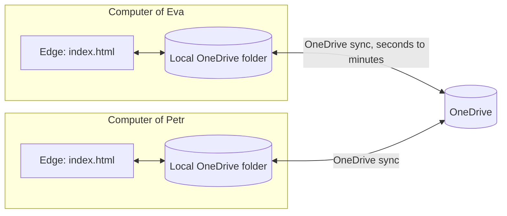
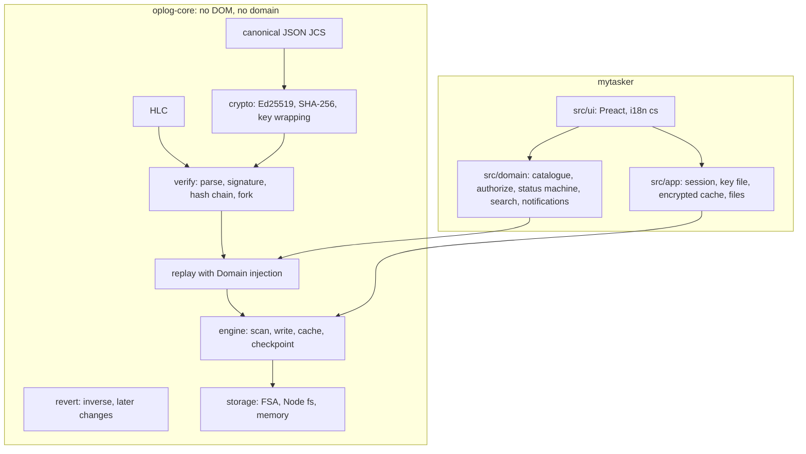
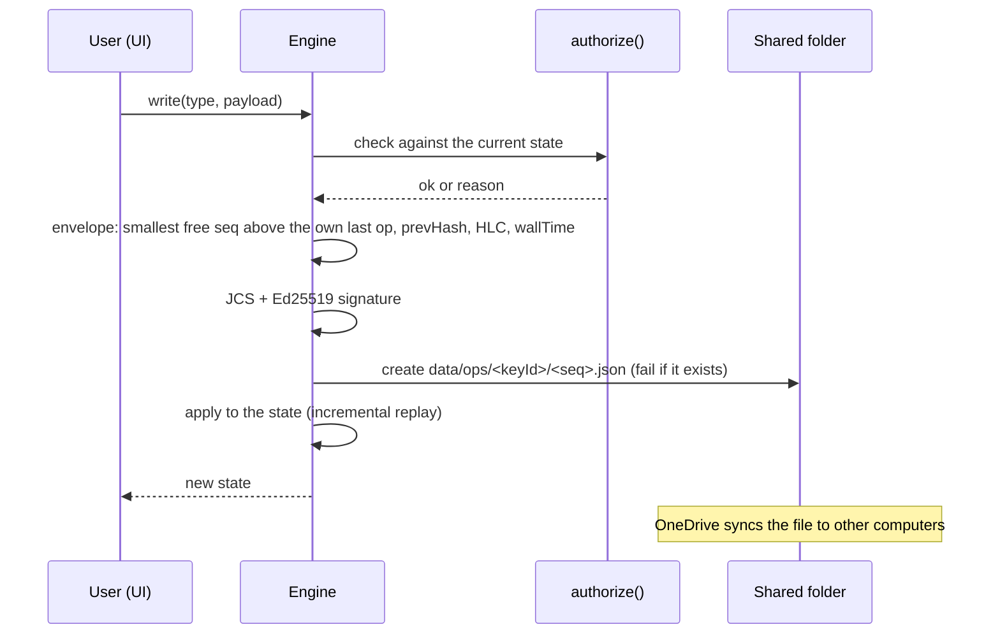
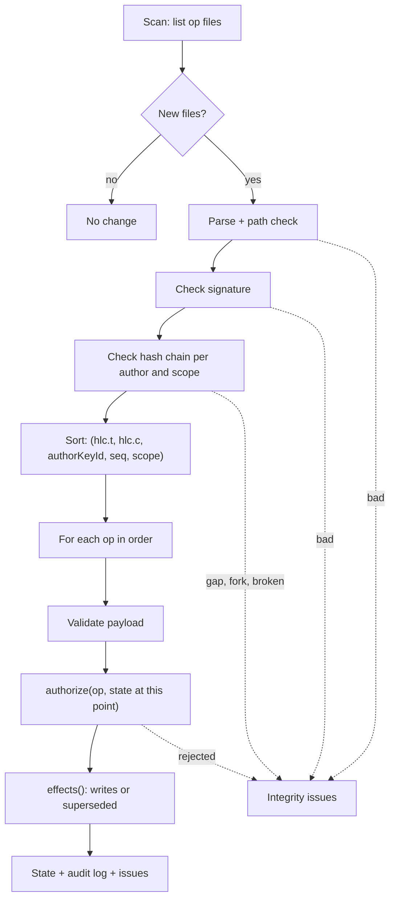
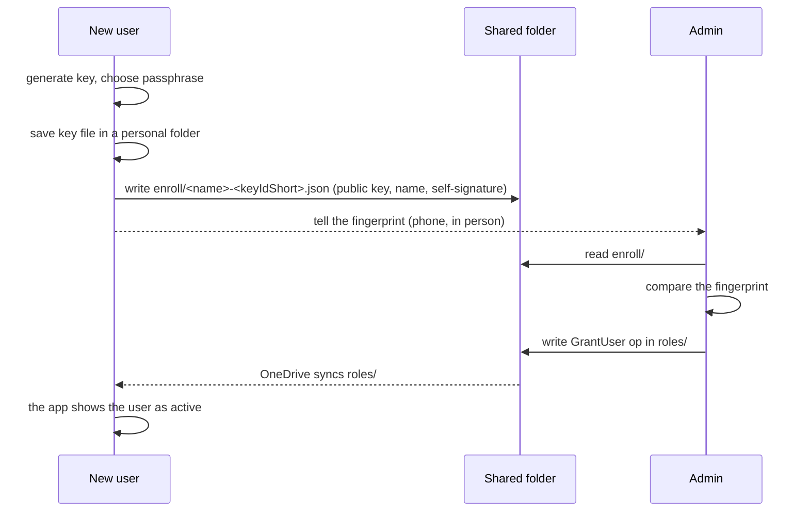

# Architecture

Status: design (Phase 2). A `Q-` number refers to an answered question in `docs/open-questions.md`.

## 1. Summary

"Úkoly" (repository `mytasker`) is a task manager for a small team. It has no server.

- The app is 1 HTML file in a shared OneDrive folder. Each user opens it from the local copy of the folder over `file://` in Edge or Chrome.
- The app reads and writes the local copy with the File System Access API. OneDrive syncs the folder between the computers.
- Each change is an **op**: 1 new, signed, immutable JSON file. Nobody changes or deletes an op file. Thus OneDrive does not make conflict copies of op files.
- Each client reads all ops, checks them, and replays them in 1 deterministic order. All clients that have the same set of ops show the same state.



## 2. Code structure

The generic part of the code is in a separate repository, `oplog-core` (ADR 0001). Other apps with the same architecture can use `oplog-core` too.



The `Domain` interface of `oplog-core` (`oplog-core/src/domain.ts`). mytasker implements it in `src/domain/domain.ts`:

| Member | Content in mytasker |
|---|---|
| `scopeDir`, `scopeFromDir`, `discoverScopes` | The scopes `roles` and `data`, each in the folder with the same name |
| `catalog` | The op catalogue (`src/domain/catalog.ts`, `docs/data-model.md` §5) |
| `authorize` | The permission matrix (`src/domain/permissions.ts`, `docs/data-model.md` §6) |
| `rootState`, `keyOwner`, `keysIn`, `isAdmin` | Users and keys. The root admins of the trust root are protected (`root: true`). |
| `revocations`, `isRevocation` | Cutoffs from `RevokeKey` and `RemoveUser` |
| `normalize` | The derived status rules (`docs/data-model.md` §9) and the count `assigneeCount` |
| `checkState` | No cycle of merged tags |
| `removeWrites` | The writes for a `Revert` of a create op (`docs/data-model.md` §8) |
| `isDerived` | `task.assigneeCount`: a `Revert` does not write it, `normalize` computes it again |

`effects()` can return `{ superseded: reason }`. The replay records it in the audit log with the status `superseded`. `superseded` is an audit status in `oplog-core`. An error in domain code rejects only that op (issue kind `domain`).

## 3. Folder layout and OneDrive permissions

```text
<SharedRoot>/
  app/                index.html, trust-root.json, VERSION, SHA256SUMS
  roles/ops/<keyId>/<seq>.json
  roles/checkpoints/<keyId>/<seq>.json
  data/ops/<keyId>/<seq>.json
  data/checkpoints/<keyId>/<seq>.json
  data/files/<sha256>
  enroll/<name>-<keyIdShort>.json
```

| Folder | Write | Read | Note |
|---|---|---|---|
| `app/` | admins | all | The trust root and the app. Supply-chain point. |
| `roles/` | admins | all | Users, keys, roles, verifier flags, settings. |
| `data/` | all | all | Task ops, checkpoints, attachment blobs. |
| `enroll/` | all | admins | Enrollment requests. Q-17: OneDrive cannot give "write but not read" to a user in all cases. |

All users can read all tasks (Q-1).

The OneDrive permissions are the first barrier. The second barrier is in each client: `authorize` rejects an op in `roles` from a non-admin, also if a user can write to the folder.

File names:

- `seq` has 10 digits with leading zeros: `0000000017.json`.
- `keyId` is `k` + 24 base32 characters (`a-z`, `2-7`) of the SHA-256 of the public key. The `k` is a constant prefix.
- The scan ignores files with other names, for example `0000000017-EVA-PC.json` (a OneDrive conflict copy). The integrity view lists them.
- Attachment blobs: `data/files/<sha256>`, with exactly 64 lowercase hex characters. The client validates the hash before it uses it in a path.
- Enrollment requests: `enroll/<name>-<keyIdShort>.json`. `<name>` comes from the display name: remove the diacritics, use lowercase, keep only `a-z` and `0-9`, replace each sequence of other characters with 1 `-`, remove `-` at the start and the end, and limit it to 32 characters. `<keyIdShort>` is the 8 characters of the key ID after the `k`. The admin's client uses only the content of the file (public key and self-signature), never the file name, to make the `GrantUser` op.

## 4. Op lifecycle



The engine creates the file with "fail if it exists". If 2 tabs of the same user write the same `seq`, 1 write fails. The tab reads the folder again and retries.

## 5. Scan and replay



- **Polling**: the default is every 15 seconds (setting `pollSeconds`). The UI also has a refresh button. If `FileSystemObserver` exists (Chromium 155 has it), the app uses it, and polling is a fallback.
- **Cache**: the client keeps verified ops (never the state) and the read state of notifications in IndexedDB. The cache is encrypted (ADR 0006). A file is verified 1 time. The state is always replayed from the ops. If the trust root changes, the engine does a full replay.
- **Replay**: the full replay is in memory, from the trust root. New ops that sort after the last applied op are applied incrementally. Else the engine does a full replay. Tests check that both paths give the same state.
- **Checkpoints**: an admin writes a signed pack of the original ops (ADR 0007). A new client reads 1 large file instead of many small files. The engine uses the ops of a pack only if the pack signature is valid and its author is an admin. Else it reads the op files. Thus a pack cannot hide or replace a valid op file.
- **Chains** (ADR 0014): only validly signed ops of the author are members of the chain. Any other file in the author folder (garbage, a changed op, a misplaced copy) is an integrity issue, and the chain skips it. The chain follows the `prevHash` links. `seq` must increase but can have gaps. An op whose previous op is missing or changed waits (`chain-gap`). Usually the missing file is not synced yet. If the gap stays, the integrity view shows it. 2 valid ops with the same `seq` or the same `prevHash` are a fork. The writer takes the smallest free number above its own last valid op, so a file of another person under the next number does not block it.
- **HLC along a chain**: the HLC of each op must be greater than the HLC of the previous op of the same author and scope. Else the chain is broken at that op (`docs/data-model.md` §4). This check is in `oplog-core`.
- **Revocation**: the replay applies the cutoffs of all revocations to all ops of a key, with a fixpoint (`docs/data-model.md` §6).

## 6. Identity and enrollment

- Each user has an Ed25519 key pair (ADR 0003).
- The private key is in a key file in a **personal** folder, never in the shared folder. AES-256-GCM wraps the key in the key file. The wrapping key comes from the passphrase with PBKDF2-SHA256, 600 000 iterations.
- At unlock, the app imports the key as a non-extractable `CryptoKey`. The key stays in the memory of the page only.
- `app/trust-root.json` contains the public keys of the root admins. The app shows their fingerprints.



The fingerprint is the 20 characters of the key ID after the `k`, in uppercase, in 5 groups (100 bits). Example: the key ID `k7qd2mxapf4nwz3bh5rk6tyae` has the fingerprint `7QD2-MXAP-F4NW-Z3BH-5RK6`.

Bootstrap of the first admin:

1. The admin copies the release files to `app/` and makes the empty folders.
2. The admin opens `app/index.html` and selects the shared root folder.
3. The app does not find `app/trust-root.json`. It shows "Nová instalace".
4. The admin generates a key, saves the key file and writes `app/trust-root.json`.

### 6.1 Root admins and the trust root

`app/trust-root.json` has a list of root keys, each with `userId`, `displayName`, `keyId`, `publicKey` and an optional `cutoffs` (`{ roles, data }`). It is not an op. Only admins can write to `app/` (OneDrive). A change of the file changes the fingerprints that the app shows, so users can see it.

The replay rejects ops that change a root user or a root key. Thus `RevokeKey` and `AddKey` cannot change a root key. The procedure for a lost or compromised root key:

1. An admin with write access to `app/` adds a new root key to `app/trust-root.json`.
2. The admin sets `cutoffs` on the old root key: the last valid `seq` in each scope. For a compromised key, use the last `seq` that the admin trusts.
3. All clients show the new fingerprints. Each user compares them with the admin out-of-band.

Recommendation: make 2 root admins soon after the bootstrap, so the loss of 1 key does not stop the administration (`docs/operations.md` §4.1). The app cannot change the trust root. The procedures §4.1 and §4.2 change the file by hand, and `test/unit/operations.test.ts` tests them.

### 6.2 Removal of a user and key loss

Removal of a user: the admin writes `RemoveUser` with a cutoff for each key. The old ops of the user stay valid. The app then offers to remove the user from open tasks (a `Batch` of `RemoveAssignee`).

Key loss: the admin writes `RevokeKey` for the old key (**Odvolat klíč** in **Správa → Uživatelé**) and the user enrolls a new key (`AddKey`).

## 7. Status state machine

See `docs/data-model.md` §9 for the diagram and the transition table.

## 8. UI

The UI is Preact (ADR 0004) with hand-written CSS. All strings are in `src/ui/i18n.ts`. See `docs/ui-wireframes.md`.

## 9. Test strategy

| Level | Content |
|---|---|
| Unit | canonical JSON vectors, signatures, chains, HLC, `authorize` (each role × each op), the full status matrix, postpone clears `due`, revocation cutoff, revert with later changes, subtask order, tag merge, attachment dedup and purge, search, notifications with an injected time |
| Property | The same ops in any order or partition give the same state (fast-check). |
| Simulation | Many simulated users write into a temporary folder with delays and partial visibility. The test checks convergence and the rejection of: a changed file, a missing file in a chain, a fork, a conflict copy, an op of a revoked key, a non-verifier that verifies, a user that deletes the task of another user. |
| Build check | 1 HTML file, no external URLs, the CSP, it loads over `file://` in Chromium. |
| E2E | Main flows in Chromium with a demo build that uses the memory storage. |
| Performance | 5 000 tasks, about 100 000 ops: cold start and refresh time. |
