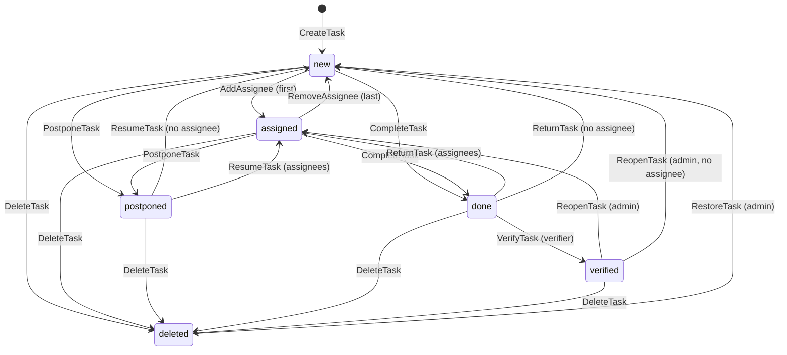

# Data model

Status: design (Phase 2). A `Q-` number refers to an answered question in `docs/open-questions.md`.

This document describes the entities, the op catalogue, the permission matrix, the status state machine and the conflict rules. `docs/architecture.md` describes the files, the replay and the enrollment.

## 1. Terms

| Term | Meaning |
|---|---|
| op | 1 change. 1 signed, immutable JSON file. |
| scope | A group of ops with its own folder: `roles` or `data`. |
| author | The key that signed the op. The key belongs to 1 user. |
| state | The result of the replay of all valid ops in the total order. |
| entity | 1 record in the state, for example 1 task or 1 comment. |
| write | 1 field change: entity type, entity ID, field, new value. |
| effects | A pure function of 1 op type. It turns the payload and the state into writes. |
| superseded | A valid, authorized op that has no effect, because the state changed before it in the total order. |
| rejected | An op that failed a check. It has no effect and shows in the integrity view. |

## 2. Scopes

| Scope | Folder | Writers (OneDrive) | Content |
|---|---|---|---|
| `roles` | `roles/` | admins | users, keys, roles, verifier flags, settings |
| `data` | `data/` | all users | tasks and all task content, tags |

Each author has 1 hash chain in each scope. The `seq` starts at 1 in each scope. Reason: an admin writes in both scopes, and the 2 folders have different OneDrive permissions.

## 3. Entities

All entities have an `id`. Entities are never removed from the state. A removed item has a status field.

### 3.1 Scope `roles`

| Entity | Fields |
|---|---|
| `user` | `displayName`, `role` (`admin` or `user`), `verifier` (bool), `status` (`active` or `removed`), `root` (bool, from the trust root) |
| `key` | `userId`, `alg` (`Ed25519`), `publicKey`, `revoked` (bool), `cutoff` (`{ roles: seq, data: seq }` or null), `root` (bool) |
| `setting` | `value`. The ID is the setting name. See §7. |

### 3.2 Scope `data`

| Entity | Fields |
|---|---|
| `task` | `title`, `description`, `status`, `due`, `createdAt`, `createdBy`, `completedAt`, `completedBy`, `completeRef` (`<opId>/<item>` of the `CompleteTask`), `assigneeCount` (derived), `verifiedAt`, `verifiedBy`, `postponedAt`, `postponedBy`, `deletedAt`, `deletedBy`, `statusBeforeDelete` |
| `assignee` | ID = `<taskId>/<userId>`. `taskId`, `userId`, `on` (bool), `by`, `at` |
| `tag` | `name`, `status` (`active`, `merged`, `deleted`), `mergedInto` (tag ID or null), `norm` (normalized name, §10.3), `order` (position of the creating op in the total order) |
| `taskTag` | ID = `<taskId>/<tagId>`. `taskId`, `tagId`, `on` (bool) |
| `subtask` | `taskId`, `text`, `pos` (fractional index), `done`, `doneBy`, `doneAt`, `status` (`active` or `removed`) |
| `attachment` | `taskId`, `sha256`, `name`, `mime`, `size`, `uploadedBy`, `status` (`active` or `removed`), `uploadedAt` |
| `blob` | ID = SHA-256 of the content. `purged` (bool), `purgedBy`, `reason`, `purgedAt` |
| `link` | `taskId`, `url`, `title`, `status` (`active` or `removed`) |
| `comment` | `taskId`, `text`, `mentions` (user IDs), `createdBy`, `createdAt`, `editedAt`, `kind` (`comment`, or `return` for the comment of a `ReturnTask`), `status` (`active` or `deleted`) |

Times on disk are ISO 8601 UTC strings. The UI shows them in the time zone Europe/Prague.

The due date is optional (Q-7). The field `due` is `null` (no due date) or 1 object `{ at, allDay }`:

- `at`: an ISO 8601 UTC time.
- `allDay`: `true` if the user gave a date without a time (Q-7a). Then `at` is the end of that day in Europe/Prague (23:59:59). The UI shows only the date.

`due` is 1 field, so "last writer wins" cannot mix `at` of 1 op with `allDay` of another op. The client computes `at` when it writes the op, so the replay does not need time-zone data.

`createdAt`, `completedAt` (default) and similar fields come from the `wallTime` of the op. The author's computer sets `wallTime`. The app cannot make sure that it is correct. The UI shows this in the history tab.

IDs of new entities are UUIDv7 strings. The client makes the ID and puts it in the payload. Thus a client knows the ID before the replay, and a retry does not make a duplicate.

A create op (`CreateTask`, `CreateTag`, `AddSubtask`, `AddAttachment`, `AddLink`, `AddComment`, `ReturnTask` for its comment) with an ID that exists already is **superseded**. It never changes the existing entity. Thus a user cannot take over the comment or the task of another user with a copied ID.

The same rule applies in `roles`: a `GrantUser` with a `userId` or a `keyId` that exists already, and an `AddKey` with a `keyId` that exists already, are superseded. Thus a `GrantUser` cannot make a removed user active again. A removed user who returns gets a new `userId`.

## 4. Op envelope

```json
{ "v": 1, "opId": "…", "scope": "data", "authorKeyId": "k…", "seq": 17,
  "prevHash": "…", "hlc": { "t": 1795080000000, "c": 0 }, "wallTime": "2026-11-19T09:30:00.000Z",
  "type": "CompleteTask", "payload": { … }, "sig": "…" }
```

- `scope` is in the envelope and in the path. A mismatch makes the op `misplaced`.
- `prevHash` is the SHA-256 of the canonical JSON of the previous valid op of the same author in the same scope. The first op has `null`. The chain follows these links. `seq` must increase along the chain, but it can have gaps (chain format 2, Q-24, ADR 0014).
- `sig` is an Ed25519 signature over the RFC 8785 (JCS) canonical JSON of the envelope without `sig`.
- Total order: `(hlc.t, hlc.c, authorKeyId, seq, scope)`.
- The HLC must increase along the chain of an author: the HLC of an op must be greater than the HLC of the previous op in the chain. Else the op and the rest of the chain are `chain-broken`. The engine starts its HLC from the maximum of all valid ops (signature and chain checked) and its own last op, so an honest client always obeys this rule. Files that are not valid do not move the clock. Limits: `hlc.t` ≤ 253 402 300 799 999 (the year 9999), `hlc.c` ≤ 2 147 483 647. A larger value makes the op invalid.
- Clock skew (known limit): an op from a computer with a clock far in the future sorts after the concurrent ops of all other users, so it wins their "last writer wins" conflicts. A client that reads this op moves its own HLC forward to it (HLC rule). Thus the ops that a client writes after it reads the future op sort after it, and the order stays correct. But all HLC values stay ahead of the real time until the real time reaches them. A deterministic replay cannot correct this, because it cannot use the local time.
- The integrity view shows the cause with 2 checks (`future-clock`). They do not change the replay result.
  1. Deterministic: the `hlc.t` of the op is more than 1 hour after its own `wallTime`, **and** greater than the `hlc.t` of each op that sorts before it. Honest clients copy the HLC of the future op, so their ops are never greater than it, and they do not get the flag. This check also finds an op with a false HLC and an honest `wallTime`. The flag stays after the real time passes the false time.
  2. Local: the `wallTime` of the op is more than 1 hour after the local time of the reader. This flag goes away when the real time reaches the false time.

The shared library `oplog-core` defines the envelope (ADR 0001). The envelope is the same as in `system-vzdelavani`.

## 5. Op catalogue

Columns:

- **Who**: the permission. `U` = any user, `V` = verifier, `A` = admin. See §6 for the conditions.
- **Inverse**: what `Revert` writes. "before" means: the value of each written field before the op. Revert computes the inverse at revert time from the audit log (§8).

### 5.1 Scope `roles`

All ops in `roles` need the role `admin`. The replay rejects a write to a `root` user or key. The trust root (`app/trust-root.json`) is the only source for these. `docs/architecture.md` §6.1 describes the procedure for a lost or compromised root key.

| Op | Payload | Effects | Inverse |
|---|---|---|---|
| `GrantUser` | `userId`, `displayName`, `keyId`, `publicKey`, `role`, `verifier` | Makes the user and the key. The key ID must be the hash of the public key. | Not revertible. Use `RemoveUser`. |
| `UpdateUser` | `userId`, `displayName` | Changes the name. | before |
| `SetRole` | `userId`, `role` | Changes the role. | before |
| `SetVerifier` | `userId`, `verifier` | Changes the verifier flag. | before |
| `AddKey` | `userId`, `keyId`, `publicKey` | Adds a key to a user (key loss, new computer). Superseded if the user is `removed`. | Not revertible. Use `RevokeKey`. |
| `RevokeKey` | `keyId`, `cutoff` (`{ roles, data }`) | Ops of the key with a `seq` above the cutoff become invalid. | Not revertible. |
| `RemoveUser` | `userId`, `cutoffs` (per key) | `status = removed`, revokes all keys of the user with the given cutoffs. A key of the user that is not in `cutoffs` (for example, a concurrent `AddKey` of another admin) gets the cutoff `{ roles: 0, data: 0 }`: none of its ops are valid. | Not revertible. |
| `SetSetting` | `key`, `value` | Sets 1 setting (§7). | before |

### 5.2 Scope `data`: tasks and status

| Op | Payload | Who | Effects | Inverse |
|---|---|---|---|---|
| `CreateTask` | `id`, `title`, `description?`, `due?` (`null` or `{ at, allDay }`) | U | `status = new`, `createdAt`, `createdBy` | `status = deleted` (soft) |
| `UpdateTask` | `id`, `fields` (any of `title`, `description`, `due`, `completedAt`) | U. `completedAt`: see §6.1 (Q-12). | 1 write for each field | before |
| `PostponeTask` | `id`, `from` | U | §9 | before |
| `ResumeTask` | `id`, `from`, `due?` | U | §9 | before |
| `CompleteTask` | `id`, `from`, `completedAt?` | U | §9 | before |
| `VerifyTask` | `id`, `from` | V | §9 | before |
| `ReturnTask` | `id`, `from`, `commentId`, `text` | V | §9, and adds a comment | before |
| `ReopenTask` | `id`, `from` | A | §9 | before |
| `DeleteTask` | `id`, `from` | U own, A any. A `verified` task: A only (Q-21, §6.1). | §9 | before |
| `RestoreTask` | `id`, `from` | A | §9 | before |

`from` is the status that the author saw. §9 explains how the replay uses it.

### 5.3 Scope `data`: assignees and tags

| Op | Payload | Who | Effects | Inverse |
|---|---|---|---|---|
| `AddAssignee` | `taskId`, `userId` | U | `assignee.on = true`. If the task is `new`: `status = assigned`. | before |
| `RemoveAssignee` | `taskId`, `userId` | U | `assignee.on = false`. If the task is `assigned` and has no assignee now: `status = new`. | before |
| `CreateTag` | `id`, `name` | U | Makes the tag. If an active tag has the same normalized name: `status = merged`, `mergedInto` = that tag (§10.3). | `status = deleted` |
| `AddTaskTag` | `taskId`, `tagId` | U | `taskTag.on = true` | before |
| `RemoveTaskTag` | `taskId`, `tagId` | U | `taskTag.on = false` | before |
| `RenameTag` | `id`, `name` | A | Changes the name. | before |
| `MergeTag` | `id`, `into` | A | `status = merged`, `mergedInto = into` | before |
| `DeleteTag` | `id` | A | `status = deleted`. Tasks do not show the tag. | before |

### 5.4 Scope `data`: subtasks, attachments, links, comments

| Op | Payload | Who | Effects | Inverse |
|---|---|---|---|---|
| `AddSubtask` | `id`, `taskId`, `text`, `pos` | U | Makes the subtask. | `status = removed` |
| `EditSubtask` | `id`, `text` | U | Changes the text. | before |
| `CheckSubtask` | `id`, `done` | U | `done`, `doneBy`, `doneAt` | before |
| `MoveSubtask` | `id`, `pos` | U | Changes `pos`. | before |
| `RemoveSubtask` | `id` | U | `status = removed` | before |
| `AddAttachment` | `id`, `taskId`, `sha256`, `name`, `mime`, `size` | U | Makes the attachment. `size` must not be more than the limit (§7). If the blob is purged: superseded. | `status = removed` |
| `RemoveAttachment` | `id` | U | `status = removed`. The blob file stays. | before |
| `PurgeBlob` | `sha256`, `reason` | A | `blob.purged = true`. The admin's client then deletes `data/files/<sha256>`. | Not revertible (the file is gone). |
| `AddLink` | `id`, `taskId`, `url`, `title` | U | Makes the link. Only `http:`, `https:` and `mailto:`. | `status = removed` |
| `EditLink` | `id`, `url`, `title` | U | Changes the link. Only `http:`, `https:` and `mailto:`. | before |
| `RemoveLink` | `id` | U | `status = removed` | before |
| `AddComment` | `id`, `taskId`, `text`, `mentions` | U | Makes the comment. | `status = deleted` |
| `EditComment` | `id`, `text`, `mentions` | own, A | Changes the text, `editedAt`. The audit log keeps the old text. | before |
| `DeleteComment` | `id` | own, A | `status = deleted`. The audit log keeps the text. | before |

### 5.5 Ops in both scopes

| Op | Payload | Who | Effects |
|---|---|---|---|
| `Batch` | `ops`: up to 500 items `{ type, payload }` of 1 scope | each item | See below. The UI uses it for "new task with assignees, tags and subtasks" and for bulk actions. |
| `Revert` | `target` (`opId`, `hash`), `inverse` (writes) | A | §8 |

`Batch` rules:

1. A `Batch` cannot contain a `Batch` or a `Revert`. Else the batch is rejected.
2. The replay validates and authorizes each item against the state after the earlier items of the same batch.
3. If 1 item is rejected (invalid payload or not authorized), the full batch is rejected. No item has an effect.
4. A superseded item has no effect. The other items apply. Example: a `RemoveAssignee` on a deleted task in a cleanup batch.

### 5.6 Rules for all ops in `data`

- An op on a child entity (subtask, attachment, link, comment, assignee, tag link) needs an existing task.
- An op on a `deleted` task has no effect (superseded), except `RestoreTask` and `Revert`.
- A `verified` task is read-only (Q-6): only `AddComment`, `EditComment`, `DeleteComment`, `ReopenTask`, `DeleteTask` and `Revert` have an effect. Other ops are superseded. Only an admin can delete a `verified` task (Q-21).
- Text values: no control characters except line breaks in multi-line texts. The replay validates this.
- The fields `id`, `taskId`, `tagId`, `userId` and `into` must not contain `/`. These IDs are parts of composite keys (`<taskId>/<userId>`, `<taskId>/<tagId>`), and a `/` can make 2 different pairs give the same key.
- `sha256` values are exactly 64 lowercase hex characters. The replay validates this before any code uses the value in a path.
- Text limits: title 200 characters, description 20 000, comment 10 000, subtask 500, tag name 40, link URL 2 000.

## 6. Permission matrix

The matrix is data in `src/domain/permissions.ts`. `authorize(op, stateAtThatPoint)` is the only gate. The UI calls the same function to show or hide controls.

| Capability | User | Verifier | Admin |
|---|---|---|---|
| Create tasks. Edit fields, tags, subtasks, attachments, links. Add comments. | ✓ | ✓ | ✓ |
| Assign and unassign users on any task | ✓ | ✓ | ✓ |
| Postpone, resume, mark done | ✓ | ✓ | ✓ |
| Edit or delete a comment | own | own | any |
| Verify (`VerifyTask`) | — | ✓ | ✓ |
| Return for rework (`ReturnTask`) | — | ✓ | ✓ |
| Delete a task | own, not `verified` | own, not `verified` | any |
| Restore, reopen, revert | — | — | ✓ |
| Rename, merge or delete tags | — | — | ✓ |
| Purge an attachment blob | — | — | ✓ |
| All ops in `roles`, checkpoints | — | — | ✓ |

Conditions:

- **own task**: `task.createdBy` is the author's user ID, at that point in the order.
- **own comment**: `comment.createdBy` is the author's user ID.
- **No separation of duties** (Q-11): a verifier or an admin can verify a task that they marked done.

### 6.1 Rules that depend on the task status

`authorize` checks only rules that do not depend on the status of the task: the role, "own task" and "own comment". A rule that depends on the status is a guard of the state machine (§9). If a guard fails, the op is **superseded**, not rejected. Reason: the status can change because of a concurrent op of another user. That is a normal race, not an attack, so it must not show as an integrity issue or reject a full `Batch`.

| Rule | Where | Result if it fails |
|---|---|---|
| Delete an own task: not if `verified` (Q-21). Admins: always. | state machine, `DeleteTask` from `verified` | superseded |
| Change `completedAt`: only while `done`, and only by `completedBy` or an admin (Q-12). | effects of `UpdateTask` | that field write is superseded, the other fields apply |
| A `verified` task is read-only (§5.6). | effects | superseded |

The UI calls the same guards to show or hide controls.

### 6.2 Other checks of `authorize`

`authorize` also checks:

1. The key is known: an applied `GrantUser` or `AddKey` op for it sorts before the op, or the key is in the trust root.
2. The key is not revoked for this `seq` (see below).
3. For `Batch`: each item (§5.5). For `Revert`: §8.

`authorize` does **not** check the status of the user for the rights of a normal user. Admin and verifier rights apply only to an `active` user. (An honest client never writes ops for a removed user, so this difference shows only with ops of a revoked key.) A removed user's ops at or below the cutoff stay valid, also if they sort after `RemoveUser`. Reason: an offline user can sync old ops after the removal.

**Revocation is by `seq` cutoff, not by order.** `RevokeKey` and `RemoveUser` set a cutoff `{ roles, data }` for a key. The cutoff applies to **all** ops of the key, also to ops that sort before the `RevokeKey` op. Otherwise an attacker with a stolen key can write ops with an old HLC. The replay does this with a fixpoint (same as `system-vzdelavani`):

1. Replay all ops with the cutoffs of the trust root.
2. Collect the cutoffs of all applied `RevokeKey` and `RemoveUser` ops.
3. If the cutoffs changed, replay all ops again with the new cutoffs. A revocation can make another revocation invalid, so repeat until the cutoffs do not change. After 6 rounds without a stable result, the replay reports an integrity issue.
4. If 1 key has more than 1 cutoff (for example from `RevokeKey` and from `RemoveUser`), the lowest `seq` in each scope applies. (`system-vzdelavani` uses the first cutoff that it finds. `oplog-core` uses the minimum.)

**Role changes are by order, not by cutoff** (known limit). `SetRole` and `SetVerifier` apply from their point in the order. A demoted admin can still write an op with an HLC between the own last op and the `SetRole` op, and `authorize` then sees the role `admin`. The same applies to a verifier after `SetVerifier false`. Procedure for a user who is not trusted: a **root admin** writes `SetRole` or `SetVerifier`, and also `RevokeKey` with a cutoff at the last trusted `seq`, then `AddKey` with a new key (`docs/operations.md` §4.3). A root admin must do it, because a root key cannot be revoked by an op. If a non-root admin does it, the demoted admin can write a backdated `RevokeKey` against that admin. Then the 2 revocations make each other invalid, the fixpoint does not become stable, and the replay reports an integrity issue.

## 7. Settings

| Key | Type | Default | Meaning |
|---|---|---|---|
| `dueSoonDays` | int 0–30 | 2 | A task is "due soon" this number of days before `due.at`. |
| `pollSeconds` | int 5–600 | 15 | Interval of the folder scan. |
| `maxAttachmentMB` | int 1–250 | 25 | Size limit of 1 attachment. |
| `defaultTags` | tag IDs | `[]` | Tags that the "new task" form selects automatically. |

The verifier list is the `verifier` field of the users (§3.1).

The replay uses the value of a setting at the point of the op in the order. Example: `maxAttachmentMB` applies to `AddAttachment` ops after the `SetSetting` op.

## 8. Revert

1. The admin selects an op in the history or in the audit log.
2. The app computes the inverse (rules below).
3. If a later applied op wrote 1 of the same fields, the app shows a warning with these fields: the value now and the value of the reverted op. The admin must confirm. The app plans the revert again after each change of the data while the dialog is open.
4. The app writes a `Revert` op with `target` and `inverse`.
5. The replay checks the target: it must be an applied op (not superseded or rejected) in the same scope, and it must sort before the `Revert`. Else the `Revert` is rejected. Then the replay computes the inverse again from the applied writes of the target, with the same rules. The `inverse` of the payload must be equal to it. Else the `Revert` is rejected. Thus a `Revert` cannot write a value that the target did not replace. For example, it cannot set `status = verified`.
6. After the inverse, the replay applies the derived status rule (§9).
7. If the inverse would make a `mergedInto` cycle of tags, the `Revert` is superseded (§10.3).

A `Revert` writes the `before` values and does not check other rules. Example: a `Revert` of `RemoveAssignee` assigns the user again, also if an admin removed that user later. Only an admin can write a `Revert`, and the warning of step 3 shows later changes, so this is not an escalation. The admin must check the result.

Rules for the inverse:

- A field that existed before the target: the `before` value of the target's write. The `before` values are in the audit log. They do not change later, so the replay result is deterministic.
- An entity that the target created: only the "remove" writes of that entity type. For a task: `status = deleted`, `statusBeforeDelete` = the status at the point of the `Revert`, `deletedAt`, `deletedBy`. For a comment: `status = deleted`. For a tag: `status = deleted`. For a subtask, an attachment or a link: `status = removed`.
- A revert of `CreateTask`: the payload contains only `status = deleted`. The replay adds `statusBeforeDelete` (the status at the point of the `Revert`), `deletedAt` and `deletedBy` itself. These 3 fields are not compared in step 5. Thus a later `RestoreTask` has a target status, and a concurrent status change does not make the `Revert` invalid.
- A revert of `CreateTask` on a task that is already `deleted` is superseded. It does not change `statusBeforeDelete`, so a `RestoreTask` is still possible.
- A revert of any other task op, for example `DeleteTask`, carries the `before` values of all fields that the target wrote, also `statusBeforeDelete`, `deletedAt` and `deletedBy`.

Ops that are not revertible: `GrantUser`, `AddKey`, `RevokeKey`, `RemoveUser`, `PurgeBlob`. A `Revert` of a `Revert` is permitted. It writes the values again.

## 9. Status state machine

The state machine is data in `src/domain/status.ts`. Tests check the full matrix of (status × op).



`RestoreTask` returns the task to `statusBeforeDelete`. The diagram shows only 1 arrow for it.

| Op | Valid from | To | Other writes |
|---|---|---|---|
| `PostponeTask` | `new`, `assigned` | `postponed` | `due = null`, `postponedAt`, `postponedBy` |
| `ResumeTask` | `postponed` | `assigned` if the task has assignees, else `new` | `due` from the payload, if given |
| `CompleteTask` | `new`, `assigned` | `done` | `completedAt` (payload or `wallTime`), `completedBy` |
| `VerifyTask` | `done` | `verified` | `verifiedAt`, `verifiedBy` |
| `ReturnTask` | `done` | `assigned` or `new` | `completedAt = null`, `completedBy = null`, a comment |
| `ReopenTask` | `verified` | `assigned` or `new` | `verifiedAt = null`, `verifiedBy = null`, `completedAt = null`, `completedBy = null` |
| `DeleteTask` | all except `deleted`. Guard: from `verified`, only an admin (§6.1). | `deleted` | `statusBeforeDelete`, `deletedAt`, `deletedBy` |
| `RestoreTask` | `deleted` | `statusBeforeDelete` | `deletedAt = null`, `deletedBy = null`, `statusBeforeDelete = null` |

Assignee changes on a `postponed` or `done` task do not change the status. Assignee changes on a `verified` task are superseded (§5.6).

**Derived status rules.** After each applied op in `data`, the replay makes sure of these rules for each task that the op touched. The rules also apply after a `Revert`.

0. `assigneeCount` is the number of assignees with `on = true`. Only this rule writes it. A `Revert` does not write it (`isDerived`).
1. If the status is `new` or `assigned`: it is `assigned` when the task has at least 1 assignee, and `new` when it has none. Thus a revert cannot leave an `assigned` task with no assignee.
2. If the status is `new`, `assigned` or `postponed`: `completedAt`, `completedBy`, `completeRef`, `verifiedAt` and `verifiedBy` are `null`.
3. If the status is `done`: `verifiedAt` and `verifiedBy` are `null`.

Example: an admin reverts a `CompleteTask` after a `VerifyTask`. The status becomes `assigned`, and rule 2 clears the verification fields. The audit log records these writes as part of the `Revert`.

`PostponeTask` clears `due`. The audit log keeps the old value, and the history tab shows it.

`CompleteTask` with unchecked subtasks is valid. The UI shows a warning before it writes the op.

### 9.1 Concurrent status changes

Each status op has `from`: the status that the author saw.

1. Payload check: `from` must be in the "valid from" list of the op. Else the op is rejected (`invalid-payload`).
2. `authorize` checks the role.
3. The replay compares the transition with the **actual** status at that point in the order. If the transition is valid from the actual status, the op is applied. Else the op is **superseded**: no effect, the history shows it, and its author gets a notification.

Example: Eva marks a task done. At the same time, offline, Petr postpones the task. Eva's op sorts first. Petr's `PostponeTask` has `from = assigned`, but the actual status is `done`. Postpone is not valid from `done`, so Petr's op is superseded. Petr sees: "Vaše změna stavu nebyla použita, protože úkol mezitím změnil stav."

If `from` is not the actual status, but the transition is still valid, the op is applied. Example: `DeleteTask` with `from = assigned` on a `postponed` task. The history shows both statuses.

## 10. Conflict rules

| Kind of data | Rule |
|---|---|
| Scalar field (title, description, due date, subtask text) | Last writer wins for each field, in the total order. 2 edits of different fields of the same task both stay. |
| Status | §9.1 |
| Sets (assignees, tags of a task) | 1 entity for each element with the field `on`. Last writer wins for each element. A concurrent add and remove of the same element: the later op in the order wins. |
| Lists (subtasks, comments, attachments, links) | 1 entity for each item. Concurrent adds both stay. |
| Order of subtasks | Fractional index (§10.2). |
| Tag names | §10.3 |

### 10.1 Why last writer wins is acceptable

The team is small. 2 concurrent edits of the same field are rare. The history tab shows both edits, and a user can copy the lost text back.

### 10.2 Subtask order

Each subtask has a `pos` string (fractional index, base 62 digits `0-9A-Za-z`). A move writes 1 new `pos` between the 2 neighbors. All code sorts by `(pos, id)` with a comparison of code units (`<`), never with `localeCompare`. 2 concurrent moves to the same place get the same `pos`. The `id` then decides, so all clients show the same order.

If 2 neighbors have the same `pos`, no key exists between them. Then the client writes a `Batch`: new `pos` values for all subtasks of the task, in the current order, and the move. A subtask list is short, so this is cheap.

### 10.3 Tags

A user types a tag name. If an active tag has the same normalized name, the UI uses that tag. 2 users can create the same new name at the same time, offline. Then the replay merges them: the `CreateTag` op that sorts later gets `status = merged` and `mergedInto` = the first tag. If more than 1 active tag has the same normalized name (possible after a `Revert`), "the first tag" is the one whose `CreateTag` sorts first. All views follow `mergedInto`. Thus all clients show 1 tag.

Normalized name: Unicode NFD, remove the combining marks (U+0300 to U+036F), `toLowerCase()` (not `toLocaleLowerCase()`), trim, and replace each sequence of white space with 1 space. The function does not depend on the locale, so the replay stays deterministic.

Rules:

- **Resolve**: a tag ID resolves to the end of its `mergedInto` chain. A task shows each resolved tag 1 time. A task does not show a tag that resolves to a `deleted` tag.
- **No cycles**: an op whose writes would make a `mergedInto` cycle is superseded. This applies to `MergeTag` and to `Revert` (for example: merge A into B, revert, merge B into A, revert of the revert). The resolve function also stops at a tag that it saw before, as a second protection.
- `MergeTag A into B`: valid only if A and B are both `active` and different. Else superseded. Thus 2 concurrent merges `A into B` and `B into A` cannot make a cycle: the second merge in the order sees a tag that is not active.
- `RenameTag` to a normalized name of another active tag: superseded. The UI offers "Sloučit" instead.
- `RemoveTaskTag` with tag X: `on = false` for each `taskTag` of the task whose tag resolves to the same tag as X.

## 11. Attachments

1. The client computes the SHA-256 of the file.
2. If `data/files/<sha256>` does not exist, the client writes it. A file with the same content is written only 1 time (deduplication).
3. The client writes `AddAttachment` with the hash, the name, the MIME type and the size.

When the client reads a blob, it computes the hash again. If the hash is not correct, the UI shows an integrity error and does not open the file.

After `PurgeBlob`, all attachments with this hash show "odstraněno". The admin's client deletes the file. If the file is still there (for example, the delete failed), other clients do not open it. A purge is permanent: a later `AddAttachment` with the same hash is superseded, and the UI tells the user that an admin removed this file.

**Blocked types (Q-22).** The UI does not accept files with these extensions, and the replay rejects an `AddAttachment` with such a `name`: `.html`, `.htm`, `.xht`, `.xhtm`, `.xhtml`, `.shtm`, `.shtml`, `.svg`, `.svgz`, `.xml`, `.xsl`, `.mht`, `.mhtml`. The check uses the name after steps 1 to 3 below and ignores case. The UI message says only that this type cannot be attached. It does not recommend a ZIP file, because a user who extracts the ZIP file and opens the HTML file runs it in the `file://` origin (`docs/security-model.md` §4).

The **extension** of a name is the text after the last dot, also if that dot is the first character. Thus the name `.html` has the extension `html`, and the replay blocks it. A name with no dot has no extension.

**Download name.** The client makes the download name from `name` in this order:

1. Remove control characters and these characters: `<` `>` `:` `"` `/` `\` `|` `?` `*`.
2. Remove dots and spaces at the end. Windows removes them when it saves a file, so `x.html.` becomes `x.html`.
3. Limit the length to 120 characters. If the name has an extension of 1 to 10 characters, keep it and cut the base name. Else cut the full name, and the name then has no extension in step 4.
4. Compare the extension, with case ignored, with the list of safe extensions: `.pdf`, `.txt`, `.csv`, `.md`, `.rtf`, `.doc`, `.docx`, `.xls`, `.xlsx`, `.ppt`, `.pptx`, `.odt`, `.ods`, `.odp`, `.png`, `.jpg`, `.jpeg`, `.gif`, `.webp`, `.bmp`, `.tif`, `.tiff`, `.zip`, `.7z`, `.eml`, `.msg`.
5. If the extension is not on the list, or the name has no extension, add `.txt`.

Rendering rules: `docs/security-model.md` §3 and ADR 0011.

## 12. Notifications

The client computes the notifications from the state and the audit log at each refresh. There is no notification file in the shared folder.

| Kind | For | Source | ID |
|---|---|---|---|
| Due soon | assignees, or the creator if the task has no assignees | `due.at` within `dueSoonDays`, status `new`, `assigned` | `due:<taskId>:<due.at>` |
| Overdue | assignees, or the creator if the task has no assignees | `due.at` in the past, status `new`, `assigned` | `overdue:<taskId>:<due.at>` |
| Assigned to you | the user | `AddAssignee` by another user | `assigned:<opId>` |
| New comment | assignees and the creator | `AddComment` by another user | `comment:<opId>` |
| Mention | the mentioned user | `mentions` of a comment | `mention:<opId>` |
| Returned for rework | assignees and `completedBy` | `ReturnTask` | `returned:<opId>` |
| Superseded | the author | superseded op | `superseded:<opId>` |
| To verify | verifiers and admins | status `done` | `verify:<opId of the CompleteTask>` |

`<opId>` in an ID means the op ID for a plain op, and `<opId>/<item index>` for an item of a `Batch`.

The client keeps the read state locally, encrypted with the key of the user, in IndexedDB (`loadUserData` and `saveUserData` in `src/app/session.ts`). When a user starts the app for the first time, the app marks the events before that time as read (the `baseline`). The read state keeps the newest 2000 read entries (`READ_MAX`), each with the time of its notification. When an event entry is removed, the baseline moves past its time, so the event stays read. A removed due, overdue or verify entry can show again as unread. It does not remove the ID of a notification that leaves the list, because the same ID can come back (for example, a returned task is overdue again). If the load of the read state fails, the app does not save a new state: the stored state stays, and the read marks of this session stay in memory only. Due, overdue and verify notifications are states: they stay unread until the user marks them, and a new due date gives a new ID.
