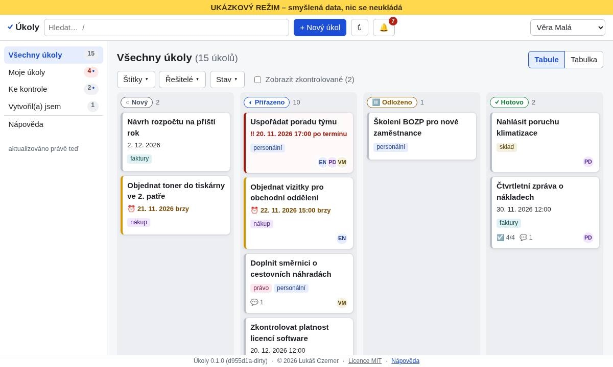
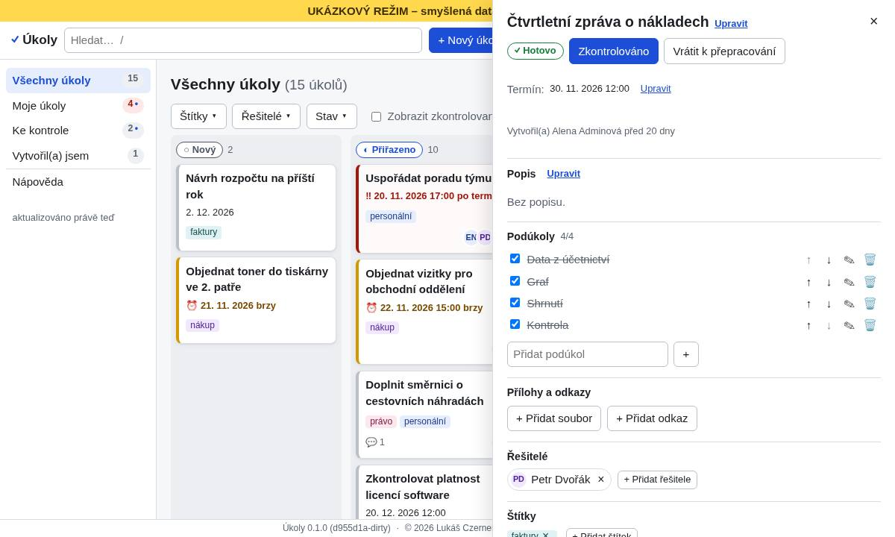
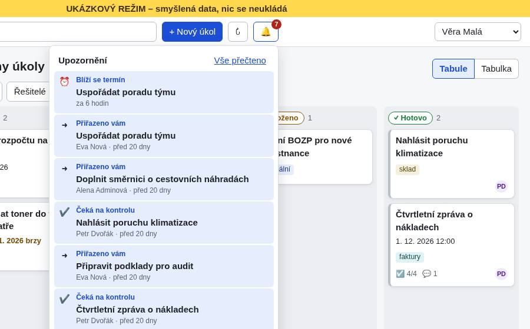

# Uživatelská příručka

Úkoly je jednoduchá aplikace pro úkoly malého týmu. Aplikace nemá server. Je to jeden soubor ve sdílené složce na OneDrive a každý ho otevírá ve svém prohlížeči. Změny se mezi počítači přenášejí synchronizací OneDrive.

Tuto příručku otevřete kdykoli klávesou **?**, odkazem **Nápověda** v levém panelu nebo v dolní liště.

## 1. Než začnete

Potřebujete:

- Microsoft Edge nebo Google Chrome ve verzi 137 nebo novější, na počítači s Windows, macOS nebo Linuxem.
- Sdílenou složku Úkoly z OneDrive, synchronizovanou na tomto počítači. Doporučení: ve Windows v Průzkumníku klikněte na složku pravým tlačítkem a zvolte **Vždy ponechat na tomto zařízení**.
- Svůj **soubor s klíčem** a **heslo** ke klíči. První den si je vytvoříte sami (kapitola 2).

> **Důležité:** Soubor s klíčem patří do vaší osobní složky, nikdy do sdílené složky Úkoly. Kdo má váš klíč a heslo, může v aplikaci jednat vaším jménem.

## 2. První spuštění: žádost o přístup

1. Ve sdílené složce na tomto počítači otevřete soubor `app/index.html` v Edge nebo Chrome. Neotevírejte ho na webu SharePoint: tam aplikace nefunguje.
2. Klikněte na **Vybrat složku** a vyberte hlavní složku Úkoly (tu, která obsahuje podsložky `app`, `roles` a `data`). Prohlížeč se zeptá na povolení přístupu. Povolte ho.
3. Klikněte na **Jsem nový uživatel / mám nový počítač**.
4. Zadejte své jméno a heslo ke klíči (alespoň 12 znaků). Heslo zadejte dvakrát.
5. Klikněte na **Vytvořit a uložit klíč**. Uložte soubor s klíčem do své osobní složky (například Dokumenty). Do sdílené složky vám aplikace soubor uložit nedovolí.
6. Aplikace sama odešle žádost o přístup a zobrazí **otisk**: 5 skupin po 4 znacích. (Pokud aplikace místo otisku ukáže tlačítko **Odeslat žádost o přístup**, klikněte na něj.)
7. Sdělte otisk správci telefonem nebo osobně. Správce otisk porovná a žádost schválí.
8. Nechte okno otevřené. Po schválení se aplikace otevře sama. Schválení se k vám dostane synchronizací OneDrive. To může trvat i několik minut.

Heslo nikam nezapisujte, hlavně ne do sdílené složky, a nikomu ho neposílejte. Správce ho nepotřebuje.

## 3. Každodenní spuštění

1. Otevřete `app/index.html` ze sdílené složky. Tip: uložte si ho do oblíbených položek prohlížeče.
2. Pokud aplikace ukáže tlačítko **Povolit přístup ke složce …**, klikněte na něj a v prohlížeči přístup povolte.
3. Zadejte heslo a klikněte na **Odemknout**. Aplikace si pamatuje, který klíč jste použili naposledy.

Když od počítače odcházíte, klikněte vpravo nahoře na **Zamknout**. Pro práci s jiným klíčem klikněte na **Použít jiný klíč**.

## 4. Co v aplikaci najdete

- **Horní lišta:** hledání (klávesa **/**), tlačítko **+ Nový úkol** (klávesa **N**), načtení změn, zvonek s upozorněními a vaše jméno.
- **Levý panel:** pohledy na úkoly (seznam níže) a nápověda.
- **Tabule a Tabulka:** přepínač vpravo nahoře. Tabule má sloupce podle stavu. Tabulku můžete řadit kliknutím na záhlaví sloupce.
- **Filtry:** štítky, řešitelé a stav. Aktivní filtr zrušíte křížkem nebo tlačítkem **Zrušit filtry**.
- **Zkontrolované úkoly** jsou skryté, protože jich stále přibývá. Zobrazíte je přepínačem **Zobrazit zkontrolované** nebo filtrem stavu.
- **Dolní lišta:** verze aplikace, licence a tato nápověda.

Pohledy v levém panelu:

- **Všechny úkoly**: všechny úkoly týmu.
- **Moje úkoly**: úkoly, kde jste řešitel.
- **Ke kontrole**: hotové úkoly, které čekají na kontrolu (pro ty, kdo kontrolují úkoly, a pro správce).
- **Vytvořil(a) jsem**: úkoly, které jste vytvořili.

Velký sloupec tabule ukáže nejdříve 100 úkolů a tabulka 200 řádků. Další úkoly zobrazíte tlačítkem pod seznamem, například **Zobrazit dalších 100**. Počet v záhlaví sloupce platí vždy pro všechny úkoly.

Hledání nerozlišuje velká a malá písmena ani diakritiku: „uctarna“ najde i „Účtárna“. Hledá v názvu, popisu, podúkolech a komentářích. Pro hledání podle štítků a řešitelů použijte filtry.

## 5. Práce s úkolem

Úkol otevřete kliknutím na kartu nebo řádek tabulky. Panel s úkolem zavřete křížkem, klávesou **Esc** nebo kliknutím mimo panel. Když máte v panelu neuložený text, panel se kliknutím mimo nezavře a aplikace vás upozorní.

### Nový úkol

Klikněte na **+ Nový úkol** nebo stiskněte **N**. Povinný je jen název. Popis, termín, řešitele a štítky můžete doplnit hned nebo později.

### Název a popis

U názvu i popisu klikněte na **Upravit**. V popisu můžete použít jednoduché formátování:

- `**tučně**` pro **tučný text**, `*kurzíva*` pro *kurzívu*, obrácené apostrofy pro `kód` (na české klávesnici pravý Alt a klávesa ý).
- Řádky začínající `- ` tvoří seznam, řádky začínající `1. ` číslovaný seznam.
- Odkazy: `[text](adresa)`. Aplikace povolí jen adresy začínající `http:`, `https:` a `mailto:`.

### Termín

Termín je nepovinný. Zadejte datum a případně čas. Bez času platí termín do konce dne (23:59). Všechny časy jsou uvedeny v českém čase.

Úkol **blízko termínu** má žlutou značku, úkol **po termínu** červenou. Kolik dní předem se úkol označí, nastavuje správce.

### Podúkoly

Do pole **Přidat podúkol** napište text a stiskněte **Enter**. Splněný podúkol zaškrtněte. Šipkami změníte pořadí, ikonou tužky upravíte text a ikonou popelnice podúkol odeberete.

### Přílohy a odkazy

- **+ Přidat soubor** nahraje soubor do sdílené složky. Výchozí maximální velikost přílohy je 25 MB, správce ji může změnit.
- Z bezpečnostních důvodů aplikace nepřijme soubory HTML, SVG, XML a podobné (mohly by obsahovat skript). Takový soubor nepřikládejte. Pokud ho kolegové potřebují, převeďte ho například do PDF.
- Obrázky (PNG, JPEG, GIF, WebP) mají náhled. Každý soubor stáhnete tlačítkem **Stáhnout**.
- Když správce soubor trvale odstraní (například dokument přiložený omylem), u přílohy se zobrazí „odstraněno“ a soubor už nejde stáhnout.
- **+ Přidat odkaz** přidá odkaz na web nebo e-mail.

### Řešitelé a štítky

- **+ Přidat řešitele** přiřadí úkol kolegovi. Úkol může mít více řešitelů. Řešitele odeberete křížkem.
- **+ Přidat štítek** přidá štítek. Napište název. Když štítek neexistuje, aplikace nabídne jeho vytvoření.

## 6. Stavy úkolu

- **Nový**: úkol nemá řešitele.
- **Přiřazeno**: úkol má aspoň jednoho řešitele. Stav se mění sám, když přidáte prvního řešitele nebo odeberete posledního.
- **Odloženo**: práce na úkolu čeká. Odložení smaže termín. **Pokračovat** vrátí úkol do práce a můžete zadat nový termín.
- **Hotovo**: práce je dokončená. Aplikace se zeptá na datum dokončení (předvyplní dnešní datum). Když má úkol nesplněné podúkoly, aplikace vás upozorní.
- **Zkontrolováno**: kontrola potvrdila, že je úkol hotový. Zkontrolovaný úkol už nejde měnit, jen komentovat. Znovu ho otevřít může jen správce.
- **Smazáno**: úkol je v koši. Obnovit ho může jen správce.

Kdo co smí:

- Každý může vytvářet úkoly, měnit je, přiřazovat řešitele, odkládat úkoly a označovat je jako hotové.
- Označit úkol jako **Zkontrolováno** nebo ho **Vrátit k přepracování** může jen ten, kdo kontroluje úkoly (toto právo přiděluje správce), a správce. Při vrácení je povinný komentář s důvodem.
- Úkol může smazat jeho autor (kromě zkontrolovaného úkolu) a správce.

Tlačítka pro akce, ke kterým nemáte oprávnění, aplikace nezobrazí.

## 7. Komentáře a zmínky

Komentář napište do pole dole v panelu a klikněte na **Odeslat**. Kolegu zmíníte tak, že napíšete `@` a jeho celé jméno přesně tak, jak je v aplikaci, například `@Petr Dvořák`. Zmíněný kolega dostane upozornění.

Svůj komentář můžete upravit nebo smazat. Správce může upravit a smazat každý komentář. Komentovat jde i zkontrolovaný úkol.

## 8. Upozornění

Zvonek v horní liště ukazuje počet nepřečtených upozornění. Upozornění dostanete, když:

- se blíží termín vašeho úkolu nebo už uplynul,
- vám někdo přiřadí úkol,
- někdo přidá komentář k vašemu úkolu nebo vás v komentáři zmíní,
- vám někdo vrátí úkol k přepracování,
- vaše změna nebyla použita (viz kapitola 10),
- hotový úkol čeká na kontrolu (pro ty, kdo kontrolují úkoly, a pro správce).

Kliknutím na upozornění otevřete úkol a upozornění se označí jako přečtené. **Vše přečteno** označí všechna upozornění jako přečtená. Počet nepřečtených vidíte také v názvu karty prohlížeče. Tečka u pohledu v levém panelu znamená, že pohled obsahuje úkol s nepřečteným upozorněním.

Po spuštění aplikace se nahoře ukáže krátký přehled: úkoly po termínu a úkoly ke kontrole.

## 9. Historie úkolu

Karta **Historie** v panelu úkolu ukazuje všechny změny úkolu: kdo, kdy a co změnil, například „Název: Starý → Nový“. Kliknutím na změnu zobrazíte podrobnosti. Čas změny je podle hodin počítače autora.

Správce může změnu vrátit tlačítkem **Vrátit**.

## 10. Synchronizace a souběžné změny

- Aplikace zjišťuje nové změny každých několik sekund (interval nastavuje správce). V novějších verzích Edge a Chrome je pozná obvykle hned, jak je OneDrive uloží. Okamžité načtení: tlačítko **↻** v horní liště.
- Změny kolegů se k vám dostanou, až je OneDrive synchronizuje. Obvykle to trvá sekundy, někdy minuty.
- Když dva lidé změní stejnou věc současně, platí ta změna, která byla provedena později.
- Když kolega mezitím změnil stav úkolu, vaše změna stavu se nepoužije. Například jste chtěli úkol odložit, ale kolega ho už označil jako hotový. Aplikace vás upozorní a v historii je změna označená „nepoužito“.
- Můžete pracovat i bez připojení k internetu. Změny se odešlou, až se OneDrive znovu připojí.

## 11. Klávesové zkratky

- **N**: nový úkol.
- **/**: hledání.
- **?**: tato nápověda.
- **Esc**: zavře panel, dialog nebo seznam upozornění. V textovém poli panelu nejdříve opustí pole.
- **Tab** a **Shift+Tab**: další a předchozí ovládací prvek. Po prvním stisku **Tab** se zobrazí odkaz **Přejít na obsah**.
- **Enter** na kartě nebo řádku: otevře úkol.

## 12. Bezpečnost: klíč a heslo

- Soubor s klíčem mějte jen ve své osobní složce. Pro jistotu si ho zálohujte (například na šifrovaný disk).
- Heslo nikomu neříkejte, ani správci.
- **Zapomenuté heslo nebo ztracený klíč:** heslo nejde obnovit. Na úvodní obrazovce klikněte na **Použít jiný klíč** a pak na **Jsem nový uživatel / mám nový počítač**. Vytvořte nový klíč. Požádejte správce, aby žádost schválil jako nový klíč pro vás a starý klíč odvolal.
- **Nový počítač místo starého:** zkopírujte soubor s klíčem na nový počítač (do osobní složky). Na úvodní obrazovce klikněte na **Otevřít soubor s klíčem** a vyberte ho. Na starém počítači pak už s tímto klíčem nepracujte.
- **Další počítač (například notebook vedle stolního počítače):** jeden klíč nepoužívejte na dvou počítačích. Změny z obou počítačů by se mohly srazit a aplikace by pak vaše další změny nepoužila. Na druhém počítači si vytvořte nový klíč a požádejte správce o schválení jako nový klíč pro vás.
- **Podezření na zneužití klíče:** ihned informujte správce. Správce klíč odvolá.

## 13. Časté potíže

- **„Tento prohlížeč aplikaci Úkoly nepodporuje“:** aktualizujte Edge nebo Chrome na verzi 137 nebo novější.
- **„Ve vybrané složce chybí podsložka app“:** vybrali jste špatnou složku. Vyberte hlavní složku Úkoly, ne podsložku.
- **„Nesprávné heslo nebo poškozený soubor s klíčem“:** zkontrolujte heslo a klávesu Caps Lock. Zkontrolujte, že otevíráte svůj soubor s klíčem.
- **Nevidím změny kolegy:** počkejte na synchronizaci OneDrive a klikněte na **↻**. Zkontrolujte ikonu OneDrive na hlavním panelu: musí ukazovat, že je vše aktuální.
- **Moje změna se neuložila:** aplikace zobrazí chybové hlášení. Obvykle chybí přístup ke složce: obnovte stránku a přístup znovu povolte.
- **„Váš přístup byl ukončen“:** správce vám odebral přístup. Obraťte se na správce.
- **Aplikace zůstane hned po otevření na „Načítám data…“:** po 15 sekundách aplikace zobrazí chybu. Klikněte na **Zkusit znovu**. Pokud to nepomůže, klikněte na **Vymazat data aplikace v tomto prohlížeči** a potom na **Vymazat a načíst znovu**. Sdílená složka a úkoly zůstanou beze změny. Potom vyberte složku znovu a otevřete svůj soubor s klíčem. Pokud ani to nepomůže, zavřete ostatní karty s aplikací. V kartě s aplikací stiskněte F12, otevřete **Application** → **IndexedDB** → **mytasker** (v české verzi prohlížeče mohou mít položky české názvy) a klikněte na **Delete database**. Nepoužívejte **Clear site data**: vymaže také data jiných stránek otevřených ze souboru. Potom stránku obnovte.

## 14. Licence

Aplikace Úkoly je svobodný software pod licencí MIT. Autor: Lukáš Czerner. Text licence zobrazíte odkazem **Licence MIT** v dolní liště.
